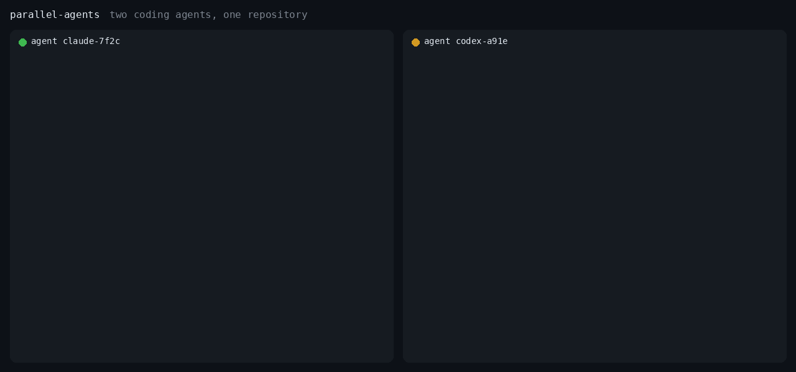

<p align="center">
  
</p>

<h1 align="center">parallel-agents</h1>

<p align="center">
  <b>Run Claude Code, Codex, Cursor and Gemini CLI on the same repo without them overwriting each other.</b>
</p>

<p align="center">
  <a href="https://github.com/Viltrumlik/parallel-agents/actions/workflows/ci.yml"></a>
  
  <a href="https://pypi.org/project/parallel-agents-cli/"></a>
  
  <a href="LICENSE"></a>
</p>

<p align="center">
  
</p>

Running several coding agents at once is the new normal. In one checkout, though, they collide: two agents edit the same file, one runs migrations while the other changes models, both start a dev server on port 3000. **parallel-agents** gives them a tiny shared protocol: **claim before you edit, see who holds what, leave a note, release.**

It's an [Agent Skill](https://agentskills.io), a `SKILL.md` plus one zero-dependency Python script, so it works in every agent that reads skills. In Claude Code a hook enforces it, so an agent that never read the skill still can't overwrite another one's work.

## How it works

```bash
pa status                                                            # who is doing what
pa claim src/billing/ --as claude-7f2c --why "add refund endpoint"   # before the first edit
pa claim @migrations --as claude-7f2c --why "add refunds table"      # shared operations too
pa note "refunds done, tests still missing" --as claude-7f2c         # handoff for the next agent
pa release --as claude-7f2c                                          # done
```

If another agent already holds something, `pa claim` refuses (exit code `3`), says who holds it and why, and the agent works on something else instead.

- **Enforced in Claude Code.** A `PreToolUse` hook claims each path before the edit and refuses the edit outright if another agent holds it. Everywhere else the skill carries the protocol.
- **Atomic.** Checking and claiming happen under one file lock. If 16 agents claim the same file at the same moment, exactly one wins (there's a test for that).
- **Never stuck.** Claims expire after 30 minutes without activity, so a crashed agent can't block the repo. Agents refresh them by re-claiming before each batch of edits.
- **Conservative.** Any doubt counts as overlap: paths compare case-insensitively, symlinks are resolved, a folder that doesn't exist yet still covers what will be created in it, and `src/**/*.py` collides with `src/app.py`.
- **Invisible to git.** State lives in the repo's git directory (`.git/parallel-agents/`). Nothing to commit, nothing to `.gitignore`. Outside git it falls back to a `.parallel-agents/` folder.
- **Worktree-aware.** All worktrees of a repo share the state. Editing the same file in another worktree isn't blocked, but you get a warning about the merge conflict ahead.
- **Files, folders, globs and resources.** `src/api/views.py`, `src/api/`, `src/**/*.py`, plus named resources like `@migrations`, `@deps`, `@port:3000` and `@db`.

## Install

**Requirements:** Python 3.9+ on macOS, Linux or Windows. Nothing to `pip install`. Git is optional: inside a repo the state goes into the git directory, outside one into `.parallel-agents/`.

**Any agent** (Claude Code, Codex, Cursor, Gemini CLI, Copilot…) with the [skills CLI](https://skills.sh):

```bash
npx skills add Viltrumlik/parallel-agents
```

**Claude Code** plugin marketplace:

```
/plugin marketplace add Viltrumlik/parallel-agents
/plugin install parallel-agents@parallel-agents
```

Installed as a plugin, the protocol is **enforced**: a `PreToolUse` hook runs before every `Edit`, `Write`, `MultiEdit` and `NotebookEdit`, claims the path for this session, and denies the edit — naming who holds it and why — if another agent got there first. Each Claude Code session is its own agent, named after its session id, so two sessions on one repo coordinate with no setup.

| Variable | Default | What it does |
|---|---|---|
| `PA_AS` | `claude-<session id>` | this agent's name on the board |
| `PA_HOOK_TTL` | `15m` | how long an auto-claim lives without a further edit |
| `PA_HOOK_MODE` | `claim` | `check` blocks without taking the path |
| `PA_HOOK_DISABLE` | unset | set to anything to turn the hook off |

If anything goes wrong — a payload it doesn't understand, a missing `pa.py`, a board that won't answer — the edit goes through. A coordination helper is never the reason a session stops working.

**Manually:** copy [`skills/parallel-agents`](skills/parallel-agents) into your agent's skills folder: `~/.claude/skills/`, `~/.codex/skills/`, `~/.gemini/skills/`, or `.agents/skills/` inside a project.

**Just the `pa` command**, to drive the board yourself from a terminal:

```bash
pipx install parallel-agents-cli
```

### Make it always-on

Skills load when an agent thinks they're relevant. To make sure every agent follows the protocol from its first edit, paste [`snippets/AGENTS.md`](snippets/AGENTS.md) into your repo's `AGENTS.md` (Codex, Cursor, Gemini) or `CLAUDE.md`.

## Commands

| Command | What it does |
|---|---|
| `pa status [--json]` | Who holds what right now |
| `pa claim PATH... --as NAME --why TEXT [--ttl 30m]` | Claim before editing. All or nothing; exit `3` if blocked |
| `pa check PATH... [--as NAME]` | Exit `0` if free (or yours), `3` if taken |
| `pa release [PATH...] --as NAME` | Release some paths, or all of yours |
| `pa renew --as NAME [--ttl 1h]` | Keep claims alive; exit `3` if nothing is held anymore |
| `pa note TEXT --as NAME [--paths ...]` | Leave a handoff note |
| `pa log [-n 10] [--json]` | Read recent notes |
| `pa gc` | Delete expired claims |
| `pa evict AGENT` | Human override: drop an agent's claims |

Every command accepts `--json`, so agents can parse the output. You can set `PA_AS` instead of passing `--as`.

Exit codes: `0` ok · `1` error (disk, lock) · `2` wrong command, nothing was claimed · `3` blocked by another agent, or nothing held.

## FAQ

**Why not just use git worktrees?** Use both. Worktrees isolate files, but the agents still share your database, ports and lockfile, and you meet their overlapping edits later as merge conflicts. parallel-agents coordinates the shared resources and warns about overlaps across worktrees while there's still time to split the work.

**Is it enforced?** In Claude Code, yes. Install it as a plugin and a `PreToolUse` hook runs before every edit: it claims the path for this session, and refuses the edit if another agent holds it. An agent that never loaded the skill still cannot overwrite another one's work. Everywhere else it's an advisory protocol that agents follow through the skill — Cursor and Codex hooks are next.

**Does it work across machines?** No, it coordinates agents that share one filesystem. That covers the common setup of several agents on your laptop or one dev box.

**Will it slow my agents down?** Each command is a single short Python process, and the skill tells agents to claim once per batch of edits, not once per edit. In Claude Code the skill adds about 130 tokens to a session and about 1,200 when it is used (`claude plugin details`).

## Roadmap

- [x] Hooks that block edits to files another agent holds — Claude Code done, Cursor and Codex next
- [ ] `pa watch`: a live terminal view of who holds what
- [ ] Editor status-bar integrations
- [ ] Claims that follow git branches

Ideas and PRs are welcome. See [CONTRIBUTING.md](CONTRIBUTING.md).

## Development

```bash
python3 -m unittest discover -s tests -v   # the full test suite, including the 16-agent race
bash demo/two-agents.sh                    # two agents sharing a throwaway repo, step by step
```

CI runs the tests on Ubuntu, macOS and Windows with Python 3.9, 3.10 and 3.13.

```
skills/parallel-agents/
├── SKILL.md              # the protocol agents read
└── scripts/
    ├── pa.py             # the `pa` CLI: one file, zero dependencies
    └── pa_hook.py        # Claude Code PreToolUse hook
pyproject.toml            # the PyPI package: pipx install parallel-agents-cli
hooks/hooks.json          # registers the hook when installed as a plugin
.claude-plugin/           # plugin and marketplace manifests
snippets/AGENTS.md        # always-on instructions for AGENTS.md / CLAUDE.md
tests/                    # end-to-end tests against real git repos
demo/                     # demo script and GIF generator
```

## License

[MIT](LICENSE) © Alisher ([@Viltrumlik](https://github.com/Viltrumlik))
